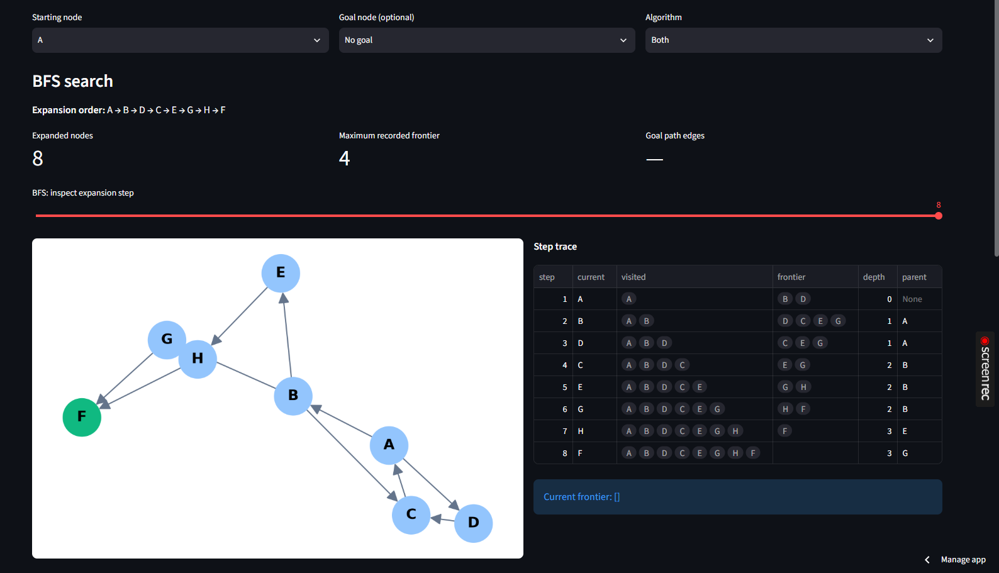
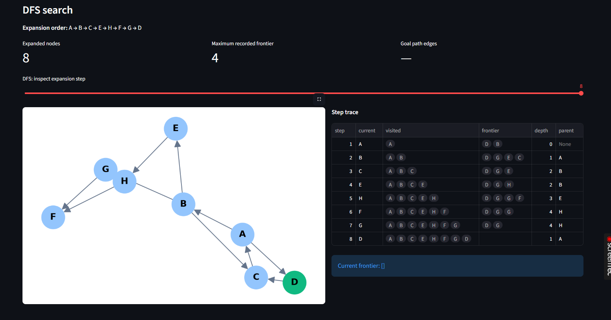

# SD24024_LAB1: BFS and DFS Interactive Traversal

**Course:** BSD3513 Introduction to Artificial Intelligence
**Student:** Gabriella Dorrie Anak Guri (SD24024), Section 02G
**Institution:** Universiti Malaysia Pahang Al-Sultan Abdullah (UMPSA)

I use the following command in the VS Code terminal to run my Streamlit application:
py -m streamlit run "C:\Users\gabbe\OneDrive\Desktop\BSD3513 INTRODUCTION TO ARTIFICIAL INTELLIGENCE\Trials\SD24024_LAB1.py"

## Live Demo[
https://sd24024lab1-9avancmzqvr3xlcvmrldaf.streamlit.app/

## Description

This Streamlit web app runs Breadth-First Search (BFS) and Depth-First Search (DFS) on a directed graph, using alphabetical tie-breaking. The user can:

- Edit the graph by typing one directed edge per line in the sidebar (for example, `A B` means A → B).
- Choose a starting node and an optional goal node.
- Run BFS, DFS, or both, and view the expansion order, the goal path, and the number of expanded nodes.
- Step through each expansion with a slider, which shows the visited set, the frontier, the depth, and the parent of each node.

## Algorithms

- **BFS** uses a first-in, first-out queue and explores the graph level by level, so it finds the shortest path in terms of edges.
- **DFS** uses a last-in, first-out stack and explores one branch as deep as possible before backtracking. Each node stores the parent and depth from the push that reached it, so the reported path is the one the search actually followed.

## Screenshots

**BFS result (start node A)**



**DFS result (start node A)**

The step trace shows G reached through H at depth 4, with parent H.



## Complexity

Both algorithms run in O(V + E) time on an adjacency list. BFS uses O(V) space for its queue, and DFS uses O(V) space for its stack in the worst case.

## Project Structure

## Running Locally

1. Clone the repository:
```bash
   git clone https://github.com/gabrielladorrie/labreport1.git
   cd labreport1
```
2. Install the dependencies:
```bash
   pip install -r requirements.txt
```
3. Start the app:
```bash
   streamlit run LabReport1.py
```
4. Open the URL that Streamlit prints (usually http://localhost:8501).

## Technologies

Python, Streamlit, pandas, NetworkX, Matplotlib, and `collections.deque`.

## Default Graph

The app starts with this graph:

A → B, A → D, B → C, B → E, B → G, C → A, D → C, E → H, G → F, H → F, H → G

With start node A, BFS visits A → B → D → C → E → G → H → F, and DFS visits A → B → C → E → H → F → G → D.
